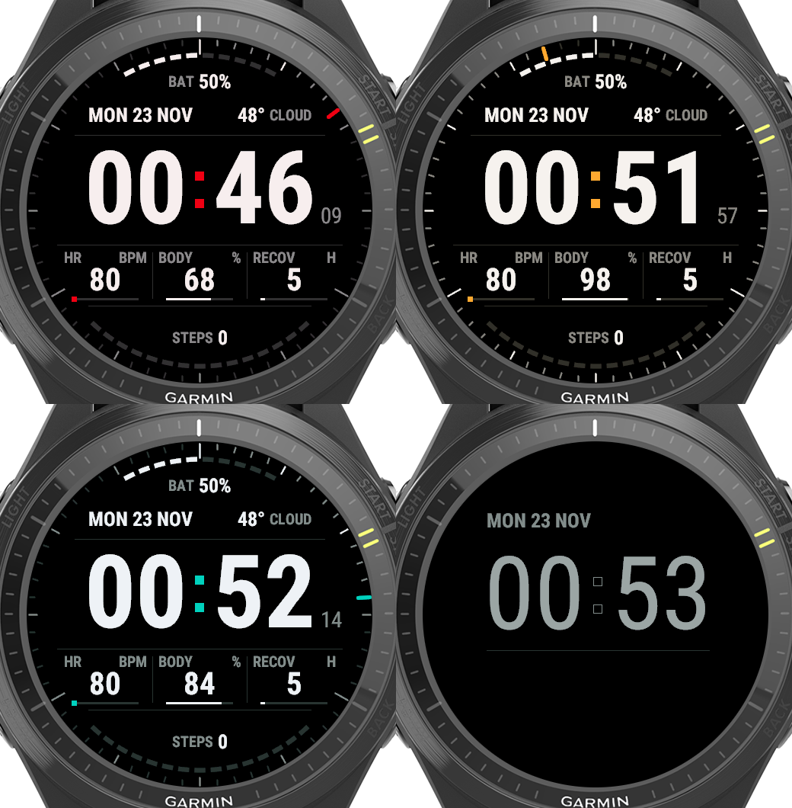

# RACE CONTROL

A Connect IQ watch face for the Garmin Forerunner 570 (42 mm and 47 mm): pit-wall
telemetry on a cycling-computer grid. Native Monkey C, no web views.



## What is on the face

| Zone | Content |
|---|---|
| Outer ring | 60-tick lap ring that fills as the minute elapses, accent head on the current second, longer marks every 20 s |
| Top arc | Battery, 10 segments (accent at 15% or less) with `BAT 50%` / `CHG` |
| Row 1 | Date on the left margin, temperature and weather on the right |
| Centre | 24-hour clock on the centre axis, square accent colon, quiet seconds |
| Cells | `HR / BPM` with live marker, `BODY / %` (accent at 20 or less), `RECOV / H` or `MIN` (accent at 48 h or more), each with a range bar |
| Bottom arc | Steps toward the daily goal, 15 segments, last one accent when the goal is reached |

Anything the watch cannot supply is shown as `--` and the rest of the face is unaffected.

**Themes:** Pit Red (default), Amber, Cyan. Change it in Garmin Connect / Connect IQ
app settings, or on the watch from the watch-face settings menu.

**Always-on:** thin grey time, outline colon, date and one rule, shifted every
minute. Measured at about 3% luminance in Garmin's burn-in tool (limit 10%).

## Build

Needs the Connect IQ SDK (built with 9.3.0), the FR570 device files, and a developer key.

```bash
export CIQ_SDK="$HOME/Library/Application Support/Garmin/ConnectIQ/Sdks/<sdk-dir>"
export CIQ_KEY=~/connectiq-sdk/developer_key.der

./build.sh              # debug build, 47 mm (DEVICE=fr57042mm for the small one)
./build.sh run          # build and load into the running simulator
./build.sh test         # unit tests in the simulator
./build.sh release      # optimised .prg to sideload
./build.sh package      # store-ready .iq for both sizes
```

Start the simulator first (`open "$CIQ_SDK/bin/ConnectIQ.app"`). To see the
always-on frame: Settings > Display Mode > Always-On.

## Layout

```
manifest.xml            products, permissions (ComplicationSubscriber, SensorHistory)
source/
  RaceControlApp.mc     app entry, settings hooks
  RaceControlView.mc    layout cache, awake frame, always-on frame
  Telemetry.mc          every sensor/system read, capability checks, fallbacks
  Fmt.mc                pure formatting + gauge maths
  Settings.mc           themes and the on-device theme menu
  Tests.mc              unit tests (stripped from release builds)
resources/              strings, theme setting, launcher icon
docs/DEVICE-NOTES.md    device-specific API limits and how each is handled
```

## Budget

| | |
|---|---|
| Runtime memory (simulator) | about 22 kB of the 124 kB watch-face heap |
| Release .prg | 26 kB (47 mm), 22 kB (42 mm) |
| Awake frame | 1 Hz; no trig, no sensor-history reads, no layout maths; three short-lived allocations |
| Slow data | at most once a minute, and once on wake |
| Always-on frame | once a minute; two glyph runs, two outlines, one date, one line; no sensor reads |

## Status

Verified in the Connect IQ simulator on both FR570 sizes. Not yet run on a
physical watch; see the "sim only" notes in [docs/DEVICE-NOTES.md](docs/DEVICE-NOTES.md).
