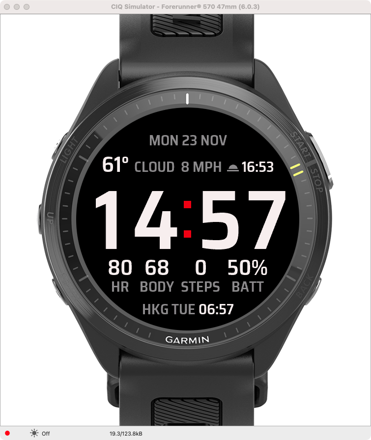

# RACE CONTROL

A Connect IQ watch face for the Garmin Forerunner 570 (42 mm and 47 mm): an
everyday face built around one very large 24-hour clock. Native Monkey C, no web views.



On the Connect IQ Store: https://apps.garmin.com/apps/0409bca7-2328-45ac-9ed1-c5623bc407c1 (1.0.0 submitted 2026-11-24, in review).

## What is on the face

| Row | Content |
|---|---|
| Date | `MON 23 NOV` |
| Weather | Temperature, condition, wind speed, today's sunset time |
| Clock | 24-hour `HH:MM`, as large as the round screen allows, centred |
| Values | `HR` (current heart rate, plain number), `BODY` (Body Battery, accent at 20 or less), `STEPS` (accent when the goal is reached), `BATT` (accent at 15% or less; `CHG` while charging) |
| Second zone | A second time zone with its weekday: `HKG TUE 19:46`. Setting: on/off, label (4 characters), UTC offset in minutes; default Hong Kong. No daylight saving. |

No text is smaller than 30 px on the 454-px screen. Anything the watch cannot
supply is shown as `--`.

**Themes:** Pit Red (default), Amber, Cyan.

**Sunset** uses the forecast's location; the last one seen is kept in app
storage so it survives a stale forecast. With no location yet, it is not shown.

**Always-on:** thin grey time in the same position, plus the date, shifted every
minute. Worst case about 6% luminance, computed from the font bitmaps (limit 10%).

## Build

Needs the Connect IQ SDK (built with 9.3.0), the FR570 device files, and a developer key.

```bash
export CIQ_SDK="$HOME/Library/Application Support/Garmin/ConnectIQ/Sdks/<sdk-dir>"
export CIQ_KEY=~/connectiq-sdk/developer_key.der

./build.sh              # debug build, 47 mm (DEVICE=fr57042mm for the small one)
./build.sh run          # build and load into the running simulator
./build.sh test         # unit tests in the simulator
./build.sh release      # optimised .prg to sideload
./build.sh package      # store-ready .iq for both sizes
```

Start the simulator first (`open "$CIQ_SDK/bin/ConnectIQ.app"`). To see the
always-on frame: Settings > Display Mode > Always-On.

## Layout

```
manifest.xml            products, permissions (ComplicationSubscriber, SensorHistory)
source/
  RaceControlApp.mc     app entry, settings hooks
  RaceControlView.mc    layout cache, awake frame, always-on frame
  Telemetry.mc          every sensor/system read, capability checks, fallbacks
  Fmt.mc                pure formatting + threshold maths
  Settings.mc           themes, second-zone settings and the on-device theme menu
  Tests.mc              unit tests (stripped from release builds)
resources/              strings, settings, launcher icon
resources-round-*/fonts bitmap fonts per screen size (generated, do not edit)
fonts-src/              the OFL typefaces they are made from (Saira, Martian Mono)
tools/fonts.sh          regenerates the bitmap fonts (tools/mkfont.py)
tools/mtp-send.c        copies a .prg to the watch over MTP
store/                  Connect IQ Store listing text, cover image, screenshot
docs/DEVICE-NOTES.md    device-specific API limits and how each is handled
```

## Budget

| | |
|---|---|
| Runtime memory (simulator) | about 17 kB of the 124 kB watch-face heap |
| Fonts | four bitmap sheets; held in the graphics pool, not the heap |
| Release .prg | about 37 kB (47 mm) |
| Awake frame | 1 Hz; cached strings, one cached heart-rate read |
| Slow data | at most once a minute, and once on wake; heart rate is the one per-second read (a cached system value), with the newest history sample as the once-a-minute fallback |
| Always-on frame | once a minute; four glyphs, two squares, one line, one date; no sensor reads |

## Status

8 unit tests pass in the simulator on both FR570 sizes. The four-column layout
with heart rate and sunset has been worn on a 47 mm watch. The store build
(second zone as a setting, sunset from the forecast's location instead of a
fixed place) has only been run in the simulator. [docs/DEVICE-NOTES.md](docs/DEVICE-NOTES.md)
was written for earlier designs and is partly out of date; see the note at its top.
